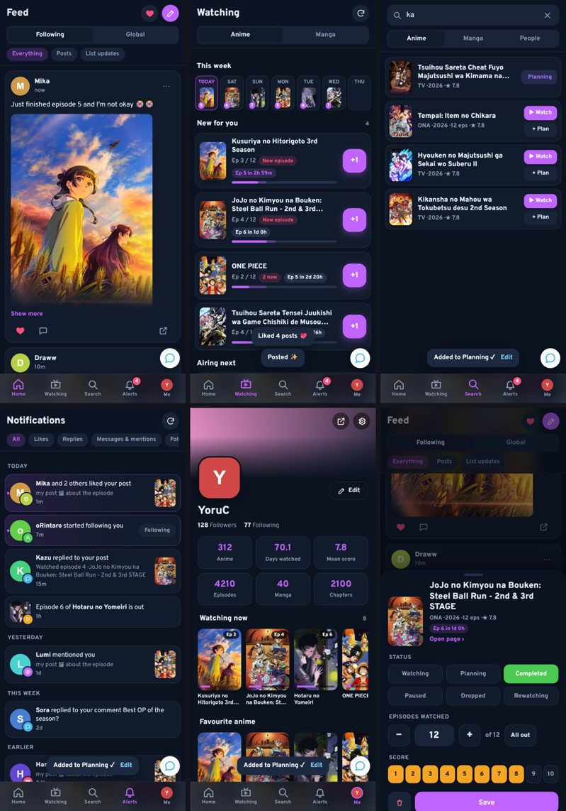

# AniList App

by **YoruC**

AniList on your phone, like an app. One install, with [AniList DMs](../dms), the [GIF & Picture Picker](../gif-picker),
[Like Previews](../like-previews) and [Chat View](../chat-compressor-mobile) inside.

- **Bottom bar**: Home · Watching · Search · Alerts · Me. The phone's Back button works like in an app
- **Feed**: Following / Global. Double-tap a post to like it, or **Like all** (the heart at the top, one a second, with Stop). Follow people right from Global. Replies open under the post, with emojis and GIFs. Pull down to refresh
- **Watching**: new episodes for you with a **+1** button (and Undo), countdowns, this week's airing, Planning with Start. Manga too
- **Search**: trending and this season's anime; tap **Watch** or **+ Plan** to add one, tap a cover for status, episodes and score
- **Alerts**: notifications with pictures of what was liked, likes on the same post grouped, Follow back
- **Profiles**: tap anyone's name; stats, watching now, favourites, followers / following with Follow buttons
- **Chats**: the chat button above the bar (AniList DMs, with live chat)
- Settings on **Me > ⚙**: dark / light, your colour, double-tap, vibration, each tool on or off

## Install (Android)

1. Get **[Firefox](https://play.google.com/store/apps/details?id=org.mozilla.firefox)** and add
   **[Tampermonkey](https://addons.mozilla.org/android/addon/tampermonkey/)** from its add-ons.
2. Open the **[install link](https://raw.githubusercontent.com/YoruCAnime/Anilist/refs/heads/main/app/anilist-app.user.js)** in Firefox and tap **Install**.
3. Already have DMs, the GIF Picker, Like Previews or Chat View? Switch those off in Tampermonkey (the app has them).

Works on PC too (Tampermonkey, same link): the bar shows in narrow windows, or set **Me > ⚙ > App mode > Always**.
Tampermonkey keeps it updated.
