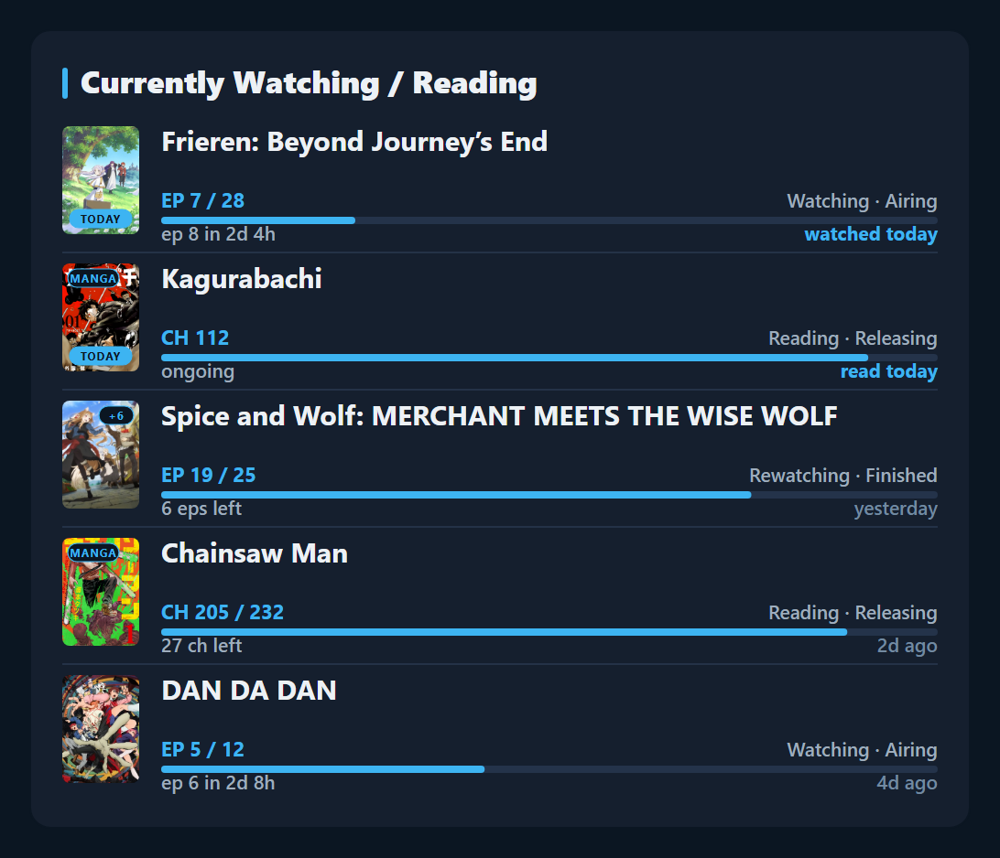

# watchreading

by **YoruC**

A "Currently Watching / Reading" card for your AniList bio that updates itself.

<p align="center"></p>

- Your 5 latest anime and manga, with progress bars and next-episode countdowns
- **TODAY** badge, **+3** on a cover when 3 aired episodes are unwatched
- Uses your AniList profile colour
- Free, runs on your own Cloudflare account. Takes about 15 minutes, no coding

## 1. Make the card (Cloudflare)

In [dash.cloudflare.com](https://dash.cloudflare.com) (free account):

1. **Storage & databases → D1 SQL database → Create Database**, name it `watchreading`.
2. **Compute → Workers & Pages → Create application → Start with Hello World!**, name it `watchreading`, **Deploy**.
3. **Edit code**, delete everything, paste in [worker.js](worker.js) (**Copy raw file** button), **Deploy**.
4. On the Worker's page: **Bindings → Add binding → D1 database**. Variable name `DB`, database `watchreading`.
5. Click your card's address at the top (`https://watchreading.yourname.workers.dev`). This is your **check page**.
   Copy the yellow key into a note.
6. **Settings → Variables and Secrets → Add**. Type **Secret**, name `PUSH_KEY`, value = your key, **Deploy**.

## 2. Install the script (Tampermonkey)

1. Get [Tampermonkey](https://www.tampermonkey.net/). Chrome / Brave / Edge: turn on **Allow User Scripts**
   (right-click its icon → **Manage extension**), or **Developer mode** if that switch isn't there.
2. Click **[Install watchreading](https://raw.githubusercontent.com/YoruCAnime/Anilist/refs/heads/main/watchreading/userscript/watchreading.user.js)** and press **Install**.
3. Open AniList and fill in your card's address, key and user name. If asked, click **Always allow domain**.

Reload your check page: every line should be green.

## 3. Add it to your bio

Copy the line from your check page into **AniList → Settings → Profile → About**:

```
~~~img100%(https://watchreading.yourname.workers.dev/card.svg)~~~
```

Done. The card now follows your list about 2 seconds after each change, while AniList is open on your computer.

**On a phone** (Firefox for Android): **⋮ → Add-ons**, add Tampermonkey, then do step 2 there. The script's menu is
under **⋮ → Add-ons → Tampermonkey**. It sends while anilist.co is open in front; for changes made in apps use step 4.

## 4. Update with your PC off (optional)

A free GitHub job updates the card every 30 minutes, which also catches changes from your phone.

1. [Make a new **public** repo](https://github.com/new) and tick **Add README**.
2. **Add file → Create new file**, twice. Use these exact names, and paste each file in with its **Copy raw file** button:
   - `.github/workflows/watchreading-sync.yml` ([file](.github/workflows/watchreading-sync.yml))
   - `sync/sync.mjs` ([file](sync/sync.mjs))
3. **Settings → Secrets and variables → Actions**, add 3 secrets: `ANILIST_USER` (your name), `CARD_URL` (your card's address), `PUSH_KEY` (your key).
4. **Actions → watchreading sync → Run workflow**. A green ✔ means it works.

## Options

Add to the end of the address in your bio, joined with `&` (`card.svg?rows=3&only=manga`):

| Option | Does |
|---|---|
| `?rows=7` | show 1 to 10 rows |
| `?only=anime` / `?only=manga` | only one of them |
| `?theme=light` | light card |
| `?accent=ff6b9d` | fixed colour |

## Problems

Open your check page first: a red line says what's missing.

| Problem | Fix |
|---|---|
| **"wrong key"** | The key must match exactly in Cloudflare, Tampermonkey and GitHub. |
| "Waiting for the first update" | Open AniList with the script on, or run the GitHub job. |
| No setup boxes on AniList | Tampermonkey icon → **watchreading: settings**. |
| **Cloudflare error** / "Cloudflare answered 404" | The card's address is wrong (often a space or typo from a phone keyboard). Open it in the browser: it must show your check page. Then **watchreading: settings** again. |
| Wrong day on TODAY | On the Worker, add a Text variable `TIMEZONE`, e.g. `Europe/London`. |

**Set up before 23 Oct 2026?** Click the install link again and press **Update**. If you did step 4, replace your `sync/sync.mjs` too.

Not affiliated with AniList, Cloudflare or GitHub. MIT licence.
